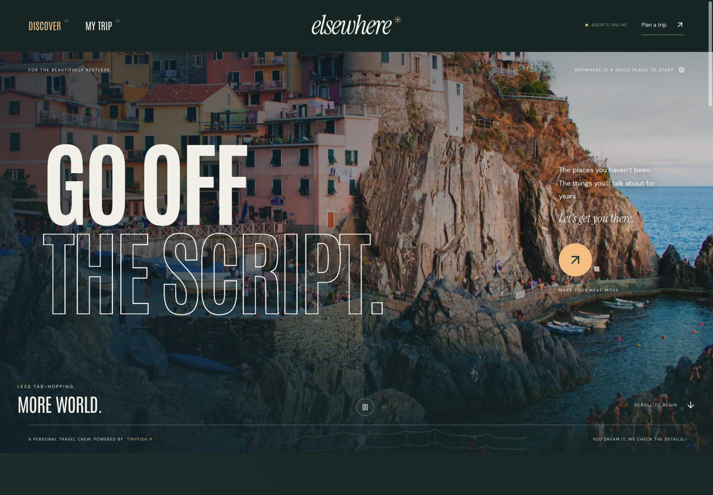
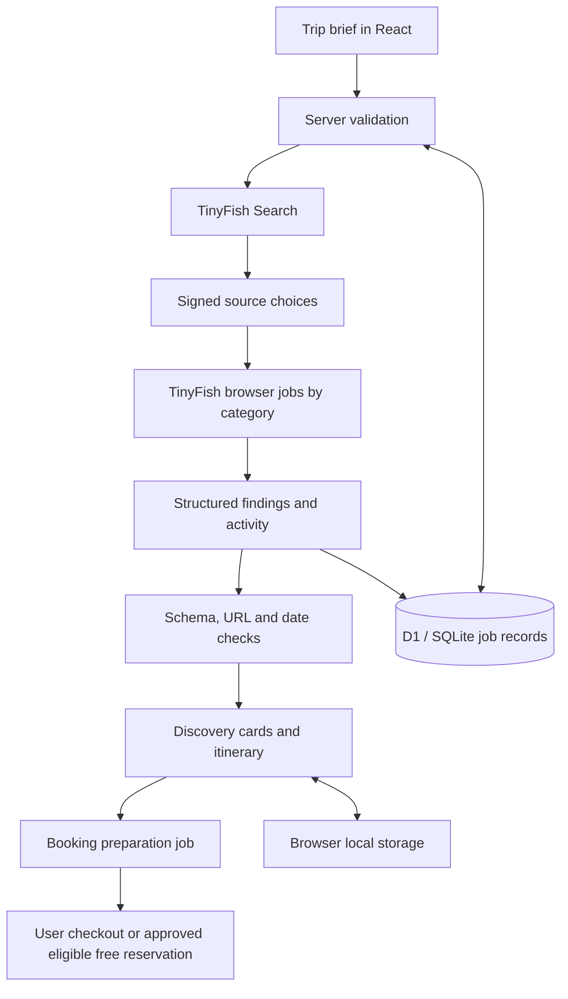

<div align="center">

# elsewhere
### Trips, put into motion.

A live travel concierge that opens booking websites, checks trip details and helps you prepare your next booking.

**Powered by TinyFish** · React · TypeScript · INR budgets

[Live app](https://cartproof.scalerailabs-4179.chatgpt.site) · [Explore the workflow](#explore-the-workflow) · [Run locally](#run-locally) · [Submission deck](submission/Elsewhere-Submission.pptx) · [Architecture](#under-the-hood)



</div>

## Why Elsewhere?

A weekend away can involve a hotel portal, a bus operator, a local rafting company and a rental shop. Each has a different calendar and booking flow.

Elsewhere turns one trip brief into separate browser tasks. TinyFish agents discover providers, interact with their public booking controls and return findings you can organise into an itinerary.

**This is a working browser-automation prototype.** Research and booking preparation run live. Paid checkout stays with the traveller. The automatic free-reservation path is implemented, but a completed real reservation has not yet been validated end to end.

## Explore the workflow

Click each stage to see what actually happens.

<details open>
<summary><strong>01 — Describe your trip</strong></summary>

Enter any destination, your departure city, future dates, adult travellers, a budget in rupees, interests and pace. Choose the categories you need:

| Stays | Getting there | Experiences | Rentals | Restaurants |
|---|---|---|---|---|
| Hotels and rooms | Flights, buses and trains | Local operators and activities | Bikes, scooters and cars | Food and table bookings |

Global destination input is supported. Successful access depends on each provider's website.

</details>

<details>
<summary><strong>02 — Watch TinyFish work</strong></summary>

The backend discovers up to four distinct source domains per category. Each browser task attempts at most two sources and returns up to three options.

Agents try to select dates and party size, inspect rooms or slots, and collect visible prices, terms and source links. The app polls activity every eight seconds. Findings appear when individual category tasks finish.

Browser execution requests a 240-second limit per job. Queue time is additional, so a five-category search can take several minutes. Selecting one category is a useful first live check.

</details>

<details>
<summary><strong>03 — Inspect the evidence</strong></summary>

Each returned option can include its provider, observed URL, date, price, availability status, cancellation terms, requirements and evidence text.

The server checks the output structure, links and date consistency. These checks do not independently prove every browser observation. Unknown prices and unconfirmed dates remain explicit.

Provider photos may fail. Any replacement photography is labelled as inspiration, not an image of that listing.

</details>

<details>
<summary><strong>04 — Build your itinerary</strong></summary>

Save individual finds or create a draft from available, date-checked options. Edit days and times, review detectable overlaps, and export JSON or a calendar file.

The draft uses deterministic rules. It does not optimise routes, traffic, transfer times or the entire trip against your budget. Calendar entries describe plans, not bookings.

</details>

<details>
<summary><strong>05 — Prepare a booking</strong></summary>

Preparation starts a separate browser task that reopens the selected option, reconstructs dates and party size, and inspects the next safe booking step.

Paid checkout, login and OTP require the traveller. A remote browser's selections are not guaranteed to transfer to the local browser.

Eligible free reservations require explicit approval, a zero total and no deposit, card guarantee or cancellation liability. A confirmation requires a provider reference. This submission path still needs real end-to-end validation.

</details>

## Under the hood



| TinyFish provides | Elsewhere adds |
|---|---|
| Web search | Travel-specific source selection |
| Remote browser execution | Bounded category tasks and durable job state |
| Website interaction and extraction | Structured contracts and date checks |
| Browser activity and results | Itinerary editing and booking approval gates |

The travel pipeline does not call a separate OpenAI or Claude API. The app uses React 19 and TypeScript with Next-style App Router files, running through Vinext/Vite. Zod validates data. D1-compatible SQLite stores jobs, with Drizzle migrations.

## Run locally

**Prerequisites:** Node 22.18+ or Node 24+, npm, and a TinyFish API key with sufficient credit. Browser runs incur real usage.

```bash
git clone https://github.com/snowhiteohno/elsewhere.git
cd elsewhere
npm ci
cp .env.example .env.local
openssl rand -hex 32
```

Edit `.env.local` privately:

```dotenv
TINYFISH_API_KEY=your_tinyfish_key
VERRO_SIGNING_SECRET=your_generated_random_secret
VERRO_LIVE_ENABLED=true
```

The `VERRO_` names are retained from the original project for compatibility. Travel research uses anonymous browser sessions and does not require saved grocery profiles.

```bash
# Avoid an inherited stale key overriding .env.local.
unset TINYFISH_API_KEY
npm run build

# Apply once for a new local database.
node --import ./scripts/sites-env.mjs ./node_modules/wrangler/bin/wrangler.js d1 execute DB --local --config dist/server/wrangler.json --persist-to .wrangler/state --file drizzle/0000_furry_the_hand.sql

npm run dev -- --host 127.0.0.1 --port 3004
```

Open **http://127.0.0.1:3004**. This address is local to your computer, not a public demo URL. The hosted app supports anonymous judge sessions; its live link is at the top of this README.

The existing `.openai/hosting.json` identifies the original hosting project. Cloning the repository does not grant access to that project. Local development is the documented path here.

## What we have validated

| Live check | Observed outcome |
|---|---|
| Lisbon hotel research | Selected dates and occupancy; returned three stay options |
| Lisbon booking preparation | Reopened a room selection and returned cancellation terms and excluded taxes |
| Kyoto experience research | Reached a tea-ceremony booking form with date-specific information; peak-period pricing still needed confirmation |

These checks took place on **1 November 2026**. They are evidence of those runs, not a guarantee of current inventory. No purchase or reservation was made during these checks.

```bash
npm test
npx tsc --noEmit --incremental false
npm run build
```

The project currently has **18 travel tests and 32 preserved legacy tests**. Tests cover validation and safeguards, not universal third-party website compatibility. Unit tests do not require live API credentials.

## Judge's notebook

<details>
<summary><strong>How is this different from a text itinerary?</strong></summary>

The browser attempts to interact with real date and availability controls. Elsewhere coordinates that research across provider categories and prepares the next booking step. Other browser agents can perform similar actions; the travel workflow is the product's contribution.

</details>

<details>
<summary><strong>Can it book without signing into every provider?</strong></summary>

Public flows often allow research and preparation without accounts. Login, OTP and paid checkout remain with the traveller when required. Anonymous research does not imply universal anonymous booking.

</details>

<details>
<summary><strong>How do prices and rupees work?</strong></summary>

Budgets use INR. Agents request INR on provider sites where available, otherwise they preserve the displayed currency. There is no automatic FX conversion. Observed totals keep currencies separate and exclude indicative prices or unchecked dates. Unknown taxes and unlisted costs can remain outside the total.

</details>

<details>
<summary><strong>How are secrets, consent and retries handled?</strong></summary>

Credentials stay server-side. Source tickets expire and bind sources to an owner. Write routes require the same origin. Unique request IDs reduce duplicate job starts. Reservation submission requires explicit approval and does not automatically retry ambiguous outcomes.

Some action boundaries are instructions to the browser agent, not a universal transaction firewall. Approved contact details go to TinyFish and the provider and may appear in their execution records. Private run logs and local databases are excluded from this repository.

</details>

<details>
<summary><strong>What are the current limits?</strong></summary>

Provider blocks, CAPTCHAs, logins and unusual booking interfaces can interrupt runs. Browser extraction can be incorrect. Source discovery does not certify operator legitimacy. The prototype supports 1–12 adults and 1–14 nights, with no child-fare logic. Queueing and browser execution affect latency and cost; no reliable average per-trip cost has been established.

</details>

## Repository guide

| Location | Purpose |
|---|---|
| [`app/page.tsx`](app/page.tsx) | Planner, discoveries, itinerary and approval UI |
| [`app/api/travel/`](app/api/travel/) | Discovery and job endpoints |
| [`lib/travel-server.ts`](lib/travel-server.ts) | TinyFish calls, source tickets and job lifecycle |
| [`lib/travel.ts`](lib/travel.ts) | Contracts, itinerary rules and currency handling |
| [`db/`](db/) and [`drizzle/`](drizzle/) | Durable job schema and migrations |
| [`tests/travel.test.mjs`](tests/travel.test.mjs) | Travel validation and safety tests |
| [`submission/Elsewhere-Submission.pptx`](submission/Elsewhere-Submission.pptx) | 12-slide pitch with technical appendix and speaker notes |
| [`docs/ENGINEERING.md`](docs/ENGINEERING.md) | Detailed implementation and runtime notes |

The previous grocery experiment remains in legacy modules and tests. Its write endpoints are retired.

## Next milestones

- [ ] Show queued and running work more clearly
- [ ] Improve time to the first useful result
- [ ] Strengthen total-price verification
- [ ] Validate a complete, explicitly approved free reservation
- [ ] Add transfer-aware itinerary scheduling

## Credits

Browser automation and search: [TinyFish](https://tinyfish.ai). Photography: Unsplash. Self-hosted fonts: Antonio, DM Sans and Instrument Serif, with licenses in [`public/fonts/`](public/fonts/). Visual inspiration: [Travel Productions](https://travelproductions.film/).

Public visitors receive a signed, HttpOnly browser cookie to isolate their jobs without login. Keep cookies enabled. Clearing cookies loses access to earlier anonymous jobs. Browser usage draws from the deployment owner’s TinyFish account, with the existing per-session job limit. This is a hackathon prototype, not a hardened public billing service.
